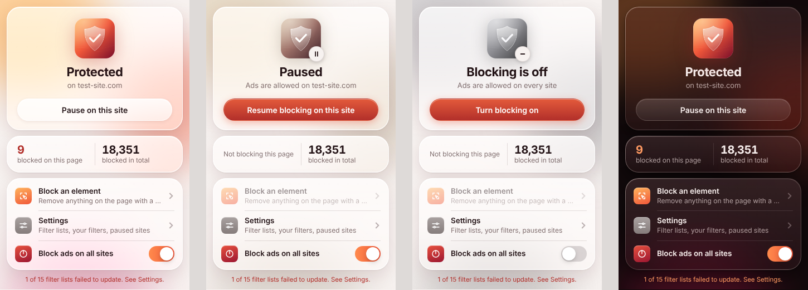
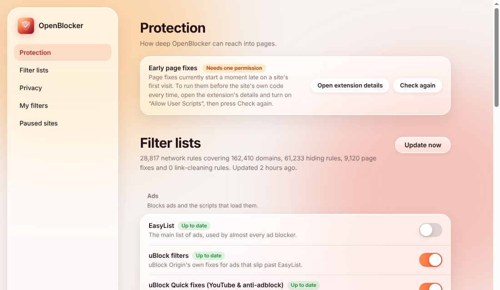

<p align="center">
  
</p>

<h1 align="center">OpenBlocker</h1>

<p align="center">
  A free, open-source ad blocker for Chrome with uBlock Origin–level filtering,<br>
  built for Manifest V3 and wrapped in a Liquid Glass interface.
</p>

<p align="center">
  
</p>

---

## Features

**Blocking**
- **15 filter lists on by default:** EasyList, EasyPrivacy, uBlock filters (Ads, Quick fixes, Unbreak, Privacy, Badware), AdGuard (Base, Mobile, Tracking Protection, URL Tracking), HaGeZi Pro, Peter Lowe's list, d3Host and StevenBlack hosts. Six optional annoyance lists (cookie banners, newsletter pop-ups, social widgets) and HaGeZi Ultimate can be turned on in Settings. All lists update daily.
- **Packs over 150,000 blocked domains** into Chrome's 30,000-rule limit by grouping 1,000 domains per rule.
- **Full filter syntax:** domain, path and regex rules, `$third-party`, `$domain=`, `$important`, exceptions, `$document`, `$redirect`, `$removeparam`, `$csp`, and entity domains like `google.*`.

**Inside pages**
- **Scriptlets:** about 45 uBlock Origin / AdGuard scriptlets (`set-constant`, `abort-on-property-read`, `json-prune`, `no-setTimeout-if`, `xml-prune`, `trusted-click-element` and more). These defeat anti-adblock walls and ad scripts. With Chrome's *Allow User Scripts* toggle on, they run before the page's own code on every visit.
- **Advanced element hiding:** `:has-text()`, `:upward()`, `:remove()`, `:style()`, `:matches-css()`, `:xpath()` and more, plus standard CSS hiding.
- **Stand-in scripts:** blocked Google ad, analytics and tag scripts are replaced with harmless versions, so pages keep working and don't detect the blocker.
- **Anti-adblock defuser:** neutralizes common ad-block detectors.

**Privacy and safety**
- **Link cleaning:** removes `utm_*`, `fbclid`, `gclid`, `msclkid` and thousands of other tracking codes from links.
- **Scam and malware warning page** with *Go back* and *Open anyway*.
- **Pop-up and pop-under blocker.**

**YouTube**
- Ads are skipped automatically, and unskippable ones play muted at 16× until they're over.
- Ad slots in the feed and sidebar are hidden.
- OpenBlocker never edits YouTube's video data, so the player doesn't go black.

**Interface**
- Popup with per-page and total counters, and a one-click pause per site.
- Element picker: click anything on a page to remove it permanently.
- Settings page with list toggles, your own filters and paused sites.
- Light and dark mode.

<p align="center">
  
</p>

## Installation

OpenBlocker isn't on the Chrome Web Store, so you load it as an unpacked extension:

1. **[Download the latest version (zip)](https://github.com/kuko30tuber-hash/OpenBlocker/archive/refs/heads/main.zip)** and unzip it, or clone this repository.
2. Open `chrome://extensions` and turn on **Developer mode** (top right).
3. Click **Load unpacked** and select the repository folder (the one containing `manifest.json`).
4. **Recommended:** click **Details** on OpenBlocker and turn on **Allow User Scripts**. This lets page fixes run before a site's own code, even on the first visit. *Settings → Protection* shows whether it's on.
5. Wait about a minute for the filter lists to download. The popup shows their status.

To update, download the latest zip again, replace the files, and click the reload ↻ icon on the extension's card. If you cloned the repository, run `git pull` instead. See [CHANGELOG.md](CHANGELOG.md) for what changed in each version.

## Project structure

```
manifest.json          Extension manifest (Manifest V3)
background.js          Service worker: list downloads, rule management, page fixes, pop-up blocker, counters
filters.js             Converts Adblock Plus / uBlock / AdGuard filter syntax to declarativeNetRequest rules
scriptlets.js          Scriptlet library (runs inside pages)
rules.json             Built-in blocking rules (generated by build_rules.py)
rules_params.json      Built-in tracking-parameter rules (generated by build_rules.py)
build_rules.py         Generates the two built-in rulesets
content/               Content scripts: element hiding, procedural filters, defuser, YouTube, element picker
resources/             Stand-in scripts and files used by $redirect rules
popup/                 Toolbar popup
options/               Settings page
blocked/               Warning page for scam and malware sites
icons/                 Extension icons
art/                   Logo source files (SVG)
docs/                  Images for this README
```

## Building the built-in rules

The built-in domain list and URL patterns live in `build_rules.py`. After editing it, run:

```bash
python3 build_rules.py
```

This regenerates `rules.json` and `rules_params.json`. Then reload the extension.

## Limitations

- Chrome's Manifest V3 caps extensions at 30,000 dynamic network rules, 5,000 redirect or header rules and 1,000 regex rules. Long lists are trimmed to fit, with domain lists packed so they barely count.
- Manifest V3 doesn't allow HTML filtering (editing a page's source before it loads), so some advanced uBlock Origin filters can't be used.
- YouTube changes its ad system often. If ads get through or playback breaks, please open an issue.

## Credits

OpenBlocker downloads filter lists from their maintainers at runtime. None of the lists are bundled in this repository, and each one keeps its own license:
[EasyList / EasyPrivacy](https://easylist.to),
[uBlock Origin filters](https://github.com/uBlockOrigin/uAssets),
[AdGuard filters](https://github.com/AdguardTeam/AdguardFilters),
[HaGeZi DNS blocklists](https://github.com/hagezi/dns-blocklists),
[Peter Lowe's list](https://pgl.yoyo.org/adservers/),
[StevenBlack hosts](https://github.com/StevenBlack/hosts) and
[d3Host](https://github.com/d3ward/toolz).

## License

The OpenBlocker source code is released under the [MIT License](LICENSE).
